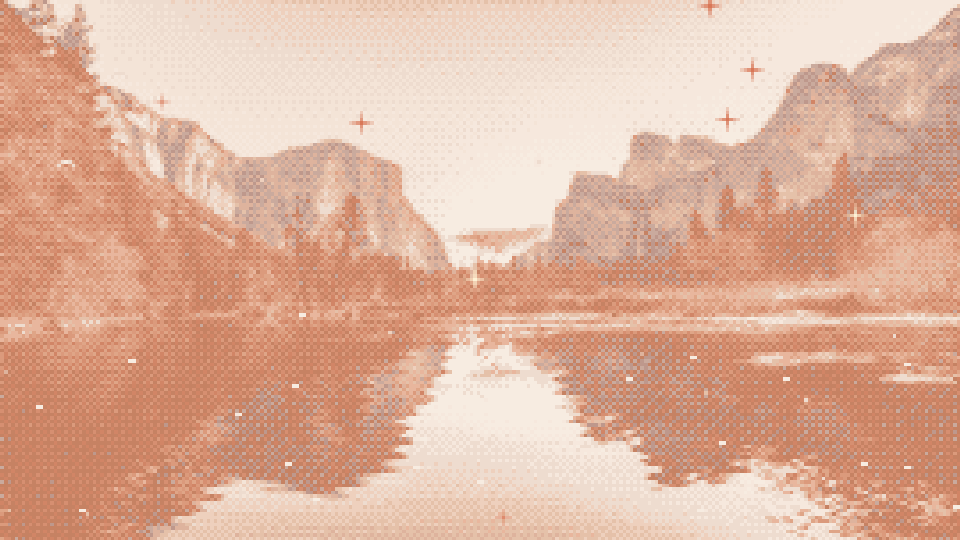
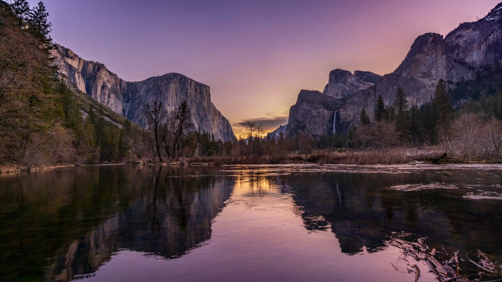
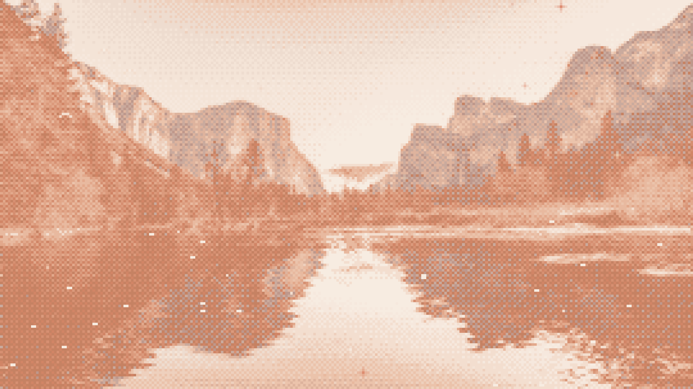
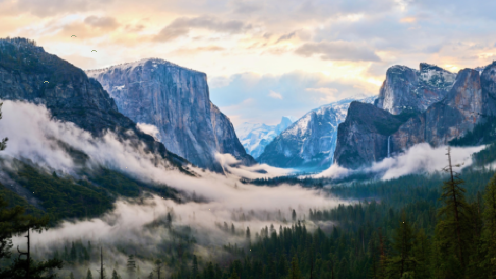
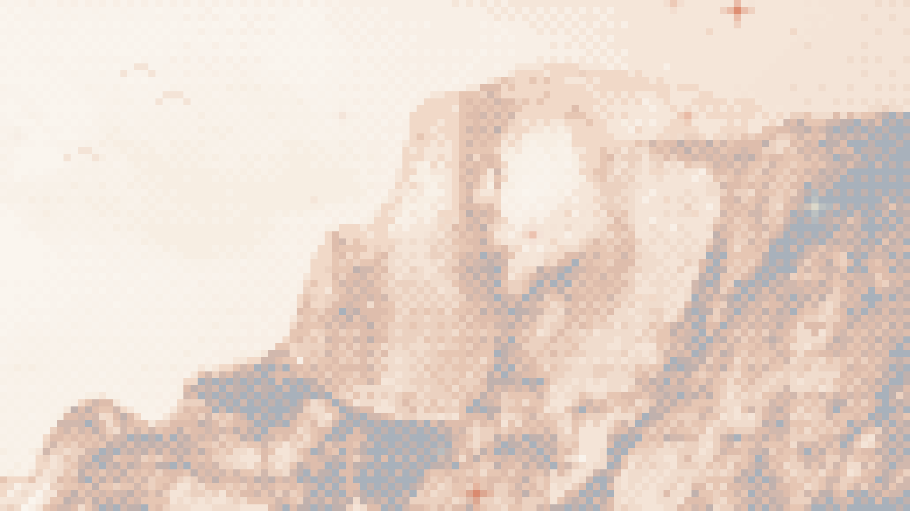
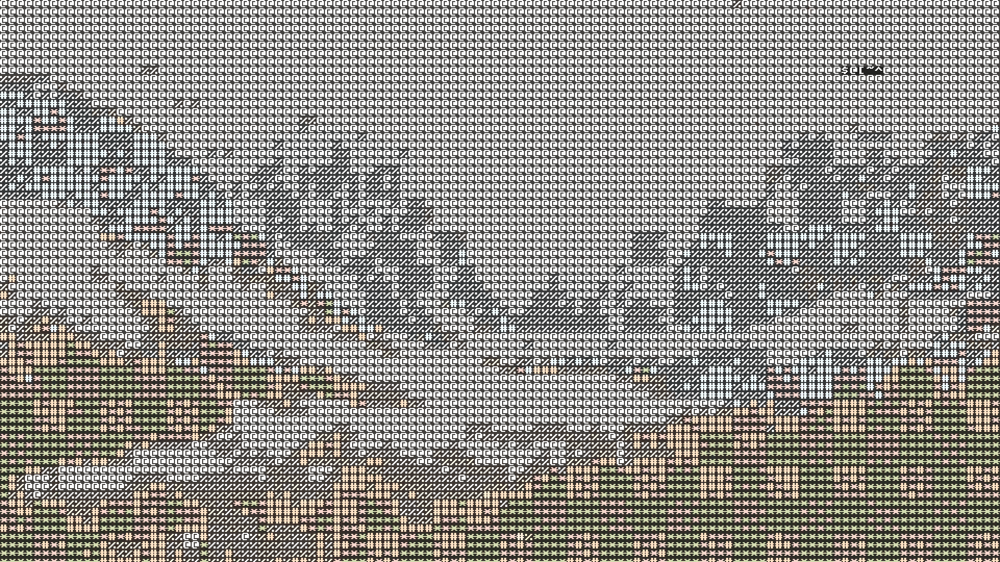
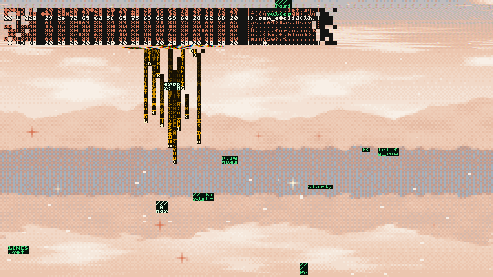
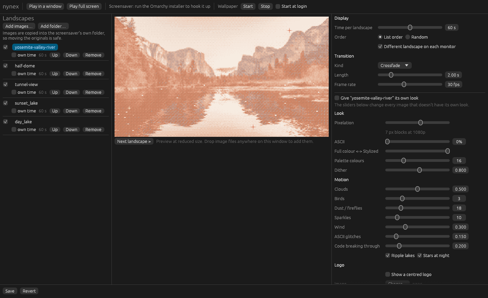
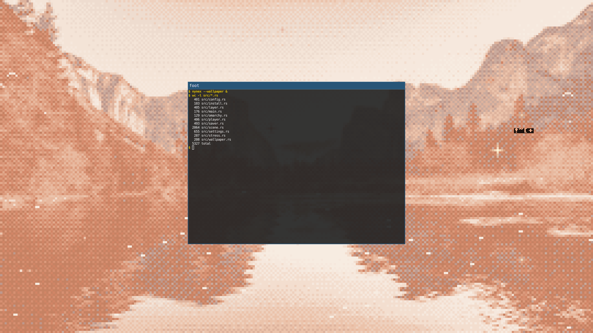

# nynex screensaver

A screensaver and live wallpaper for Windows and Linux (Wayland, made for
[Omarchy](https://omarchy.org)) that turns your landscape photos into slowly animated pixel-art and ASCII
scenes, in the spirit of the Claude FM stream visuals. Clouds drift, lakes ripple and glint, the sun
breathes, stars twinkle at night, birds glide past and motes float up. It cycles through your
landscapes with the transition you pick, and can show a centred logo.



| Your photo | What nynex makes of it |
|---|---|
|  |  |

**More:** [project website](https://kingof9x.github.io/nynex-screensaver/) ·
[how it works, for non-developers](https://kingof9x.github.io/nynex-screensaver/#inside) ·
[the code in detail](https://kingof9x.github.io/nynex-screensaver/code.html) ·
[architecture](docs/ARCHITECTURE.md) · [benchmarks](docs/BENCHMARKS.md) · [review guide](docs/REVIEW.md)

nynex is a single program of about 5,000 lines of Rust. It draws every frame on the CPU and
needs no graphics card, game engine or runtime. At 1080p the Linux wallpaper needs about 12 ms of CPU
per frame (4.5 times less than the Python prototype) and holds about 75 MB of memory most of the
time (see [benchmarks](docs/BENCHMARKS.md)).

## Looks

| | |
|---|---|
|  **Full colour**: the photo's own colours, pixelated. |  **Chunky**: pixelation turned all the way up. |
|  **ASCII**: every cell drawn as a coloured character. |  **Code breaking through**: the picture tears open to show nynex's own source, a hex dump or a crash log. |

## Install

1. Download `nynex.exe` from the latest [release](../../releases) and open it. This is the nynex
   app. Windows may warn that the file isn't signed; click **More info**, then **Run anyway**.
2. Add landscapes and tune the look. The preview updates as you go.
3. Click **Play in a window** or **Play full screen** to watch it any time.
4. Pick a wait time next to **Start after** and click **Use as my screensaver**. nynex now starts
   whenever the PC is idle that long. **Turn off** stops it. You don't need Windows' own Screen
   Saver Settings.

**Wallpaper → Start** plays nynex as your desktop wallpaper, behind the icons on every monitor,
and **Stop** brings your normal wallpaper back. Tick **Start with Windows** to start it whenever you
sign in. It uses some CPU while it runs; lower the frame rate if that matters.

**Use as my screensaver** keeps a copy of the program at
`%APPDATA%\nynex-screensaver\nynex.scr` for Windows to run. If you change the settings later, they
apply right away; after downloading a new version, click the button again to update that copy.

If something crashes, the details are written to `%APPDATA%\nynex-screensaver\crash.log`.



## Linux and Omarchy



The same `nynex` program runs on Linux. On Omarchy (Arch + Hyprland) the easiest way in is the
installer in [omarchy-pixelbook-go](https://github.com/kingof9x/omarchy-pixelbook-go/tree/main/nynex),
which installs `nynex` to `/usr/local/bin`, adds it to the app launcher and hooks it into Omarchy's
idle screensaver. By hand: download `nynex-linux-x86_64` from the latest release, put it on your
PATH as `nynex`, and run it.

- **Screensaver:** Omarchy's idle service runs `omarchy-launch-screensaver`. The installer puts a
  replacement in `/usr/local/bin` (ahead of Omarchy's in `/usr/bin`) that starts
  `nynex --screensaver --app-id org.omarchy.screensaver` on every monitor, so Omarchy's window
  rules, lock timer and "screensaver off" toggle all keep working. In the app, **My screensaver**
  switches between nynex and Omarchy's text screensaver, and **after N min** edits the idle time in
  `~/.config/omarchy/shell.json`.
- **Wallpaper:** `nynex --wallpaper` draws on a Wayland layer-shell surface (namespace
  `nynex-wallpaper`) on every monitor, under all windows and over Omarchy's own background. It only
  draws when the compositor asks for a frame, at your frame rate, and renders at the monitor's
  logical size (a HiDPI screen scales it up). **Start at login** adds it to
  `~/.config/hypr/autostart.lua`. `NYNEX_LAYER=background` puts it on the background layer instead.
- Settings and images live in `~/.config/nynex-screensaver/`; wallpaper messages go to
  `wallpaper.log` there.

## Settings

| | |
|---|---|
| **Landscapes** | Add images or a whole folder (or drop files on the window). Animated GIFs play every frame with their own timing (up to 300 frames). Untick an image to skip it, reorder it, or give it its own display time. Added images are copied to `%APPDATA%\nynex-screensaver\landscapes`; images bigger than 4K are stored downscaled to 3840 px. |
| **Own look per image** | Select an image and tick **Give it its own look**: the Look, Motion and Logo sliders then change only that image (the list marks it "own look"). **Use for all images** copies its look to the shared settings. |
| **Time per landscape** | The default display time, from 2 seconds to 30 minutes. |
| **Order / different per monitor** | List order (arrange with Up and Down) or random, and whether each screen shows a different landscape. |
| **Transition** | Crossfade, pixel dissolve, wipe, slide, pixelate, fade through black, or random, with its length. |
| **Pixelation** | From full resolution to big chunky pixels. |
| **ASCII** | Fades the picture into coloured text characters. |
| **Full colour ↔ Stylized** | From the photo's own colours to the Claude FM look: a high-key, mostly cream-white picture in a small dithered palette, with soft clay, pale blue and pale sage tints. Palette size and dither strength are adjustable. |
| **Motion** | Cloud amount, birds, dust/fireflies, sparkles, wind (faster clouds and birds, sideways dust, streaks across the sky), ASCII glitches (short runs of cells flickering into characters), code breaking through (at irregular moments the picture tears open in one of several ways: nynex's own source code, a hex dump or a crash log typing itself out in a torn band, columns of falling code, scattered blocks of code, or the picture itself glitching into posterized, colour-swapped blocks; each break picks one of five colour sets), lake ripples, night stars and frame rate. |
| **Logo** | Any image shown in the centre: a transparent PNG, or dark artwork on white. Adjust its size, opacity and breathing, and whether it has a darker rim. |

**Next landscape** under the preview plays the transition. The Left and Right arrow keys step back and forward through the enabled images in the preview, and also in the play window, full screen and the screensaver (where any other key, or moving the mouse, still closes it). The wallpaper takes no keys.

Settings are stored in `%APPDATA%\nynex-screensaver\config.json`.

## Command line

`nynex.exe` (and the `nynex.scr` copy) accepts the standard screensaver switches: `/s` (run), `/p <hwnd>` (preview box) and
`/c` (settings). It also has two switches for trying it out:

```
nynex.exe --window                                   # run in a normal window
nynex --wallpaper                                    # live wallpaper on every monitor
nynex --screensaver [--index N] [--app-id ID]        # one full-screen window, any input closes it
nynex.exe --render photo.jpg frame.png --seconds 5   # write one frame to a PNG
```

## How it works

Each photo is cropped to the screen's shape and shrunk to a grid of big pixels. It is analysed once
(where the sky is, whether there is a lake reflection, whether it is night, which 16 colours
represent it best). Then every frame adds the moving parts on the grid, snaps the colours to the
palette with a dither pattern, and scales the grid up to the screen with hard edges. The next
landscape is prepared on a background thread while the current one plays.

[docs/ARCHITECTURE.md](docs/ARCHITECTURE.md) walks through the code file by file, and the source is
commented throughout. The website has [a page on the code](https://kingof9x.github.io/nynex-screensaver/code.html)
that quotes and explains the important parts, and the main page has a
[gentler tour](https://kingof9x.github.io/nynex-screensaver/#inside) written for power users who don't program.

## Build

```
cargo build --release          # target/release/nynex.exe (or target/release/nynex on Linux)
cargo test                     # unit and stress tests (a few minutes in a debug build)
cargo test --release -- --ignored --nocapture   # long stress tests and the render benchmark
```

No system libraries are needed to build. At run time on Linux the program loads the Wayland or X11
client libraries and `libxkbcommon` that every desktop already has.

Cross-compiling from Linux works with `rustup target add x86_64-pc-windows-gnu` and MinGW
(`cargo build --release --target x86_64-pc-windows-gnu`).

GitHub Actions builds every push and pull request. To publish a release with `nynex.exe` and a zip,
open **Actions → Build and release → Run workflow**, type a version such as `v0.1.0` and click
**Run workflow**. Pushing a tag does the same:

```
git tag v0.1.0 && git push origin v0.1.0
```
